[](https://hacs.xyz/)
[](https://github.com/nimroddolev/akuvox/releases)
[](https://community.home-assistant.io/t/akuvox-smartplus-view-door-camera-feeds-open-doors-and-manage-temporary-keys/623187)

# Akuvox SmartPlus for Home Assistant

Bring your Akuvox SmartPlus account into Home Assistant to view door cameras, unlock relays, review activity, and build automations around door events.

> This is an unofficial community integration that uses SmartPlus's private cloud API. Akuvox or SmartPlus may change that API or its authentication without notice.

## What you get

- Door camera and relay entities in Home Assistant.
- An administrator-only **Akuvox SmartPlus** sidebar panel for devices, activity, temporary key management, automations, settings, and advanced account tools.
- Door-opening events (with event properties) to trigger custom automations.
- Automatic session refresh and a guided reauthentication flow when SmartPlus requires it.
- Optional local history, image & camera rotation, scoped account sharing, temporary keys, and SIP exports.

## Before you start

You need:

- A SmartPlus account that already has access to the doors or devices you want to use.
- A Home Assistant administrator account.
- HACS installed in Home Assistant.

## Install with HACS

1. Install [HACS](https://hacs.xyz/docs/installation/manual) if needed.
2. Add this repository as an **Integration**:

   [](https://my.home-assistant.io/redirect/hacs_repository/?owner=nimroddolev&repository=akuvox&category=integration)

3. Download **Akuvox SmartPlus** from HACS.
4. Restart Home Assistant.

For a manual installation, copy `custom_components/akuvox` into `<your Home Assistant config>/custom_components/akuvox`, then restart Home Assistant. Repeat the copy when updating.

## Connect your SmartPlus account

1. Go to **Settings → Devices & services → Add integration → Akuvox SmartPlus**, or use:

    [](https://my.home-assistant.io/redirect/config_flow_start/?domain=akuvox)

2. Choose the sign-in method that fits how you use SmartPlus:

    - **Email/username and password** - Enter your account's email and password to receive the emailed verification code to sign in securely.
    - **SMS** - Select your country & phone number to receive an SMS code to sign in securely.
    - **Credentials from another Home Assistant** - Use a restricted pairing link created by another Home Assistant instance running the integration. See [Share an account](#share-an-account).

The country selector chooses the SmartPlus region in most cases. If it does not, select the regional API subdomain manually during setup.

## Features

Your SmartPlus account becomes a Home Assistant hub with camera and relay devices. Open **Akuvox SmartPlus** in the sidebar for the full experience.

| Area | What you can do |
| --- | --- |
| [Devices](#devices) | View live streams and unlock relays. |
| [Latest Activity](#latest-activity) | Browse realtime door activity, including available images. |
| [Call History](#call-history) | Review recent SmartPlus calls and their available images. |
| [Automations](#automations) | Create and manage door-notification automations without YAML. |
| [Temporary Keys](#temporary-keys) | Manage your temporary keys and view their usage. |
| [Settings](#settings) | Configure events, local storage, cameras image options, account sharing and SIP account details. |

Only Home Assistant administrators can open the panel and use its sensitive controls.

### Devices

View live streams and still previews, open RTSP links, and unlock relays from the **Devices** tab.

[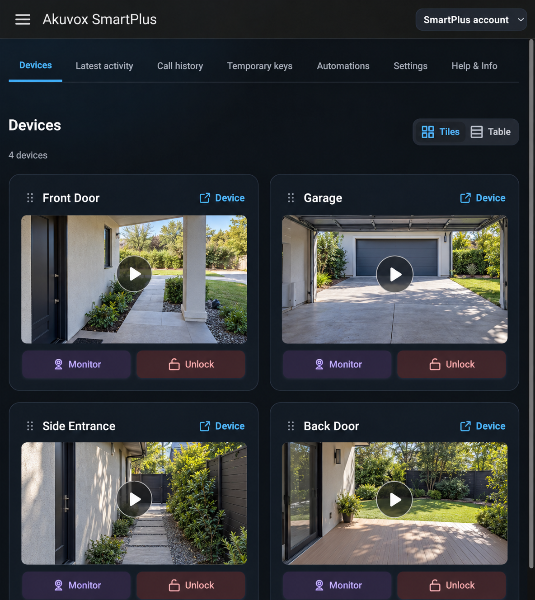](docs/images/devices-preview.png)

### Latest Activity

Browse and filter recent door activity and its available images from the **Latest Activity** tab.

[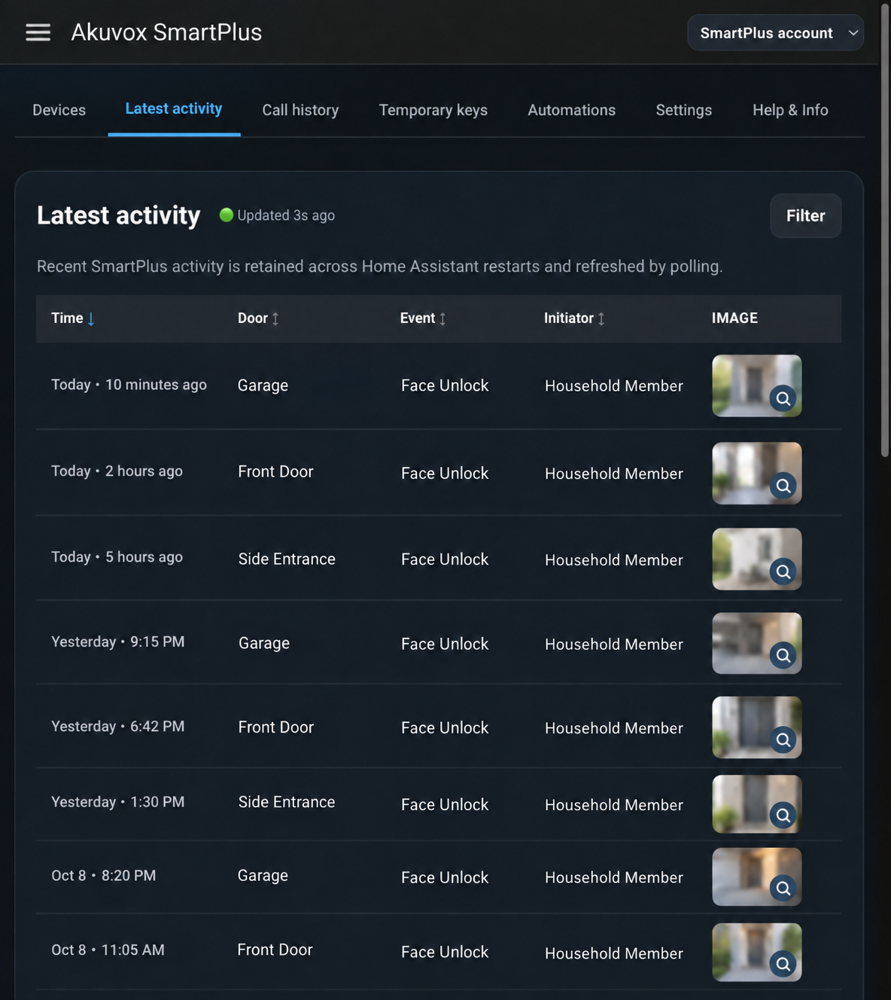](docs/images/latest-activity-preview.png)

### Call History

Review recent SmartPlus calls and their available images from the **Call History** tab.

### Temporary keys

Create, edit, delete, copy, and retrieve QR codes for temporary access from **Akuvox SmartPlus → Temporary Keys**. What you can manage depends on the permissions of the connected SmartPlus account.

[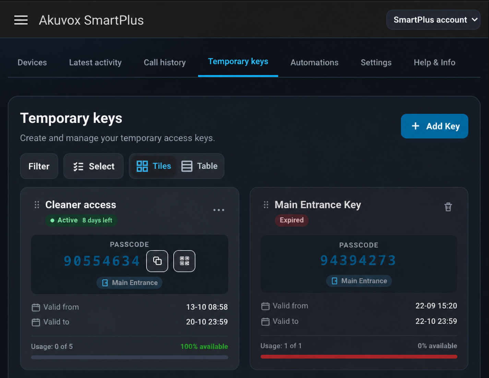](docs/images/temporary-keys-preview.png)

When editing a key, you can review its validity, usage limit, optional identifiers, and permitted relays.

[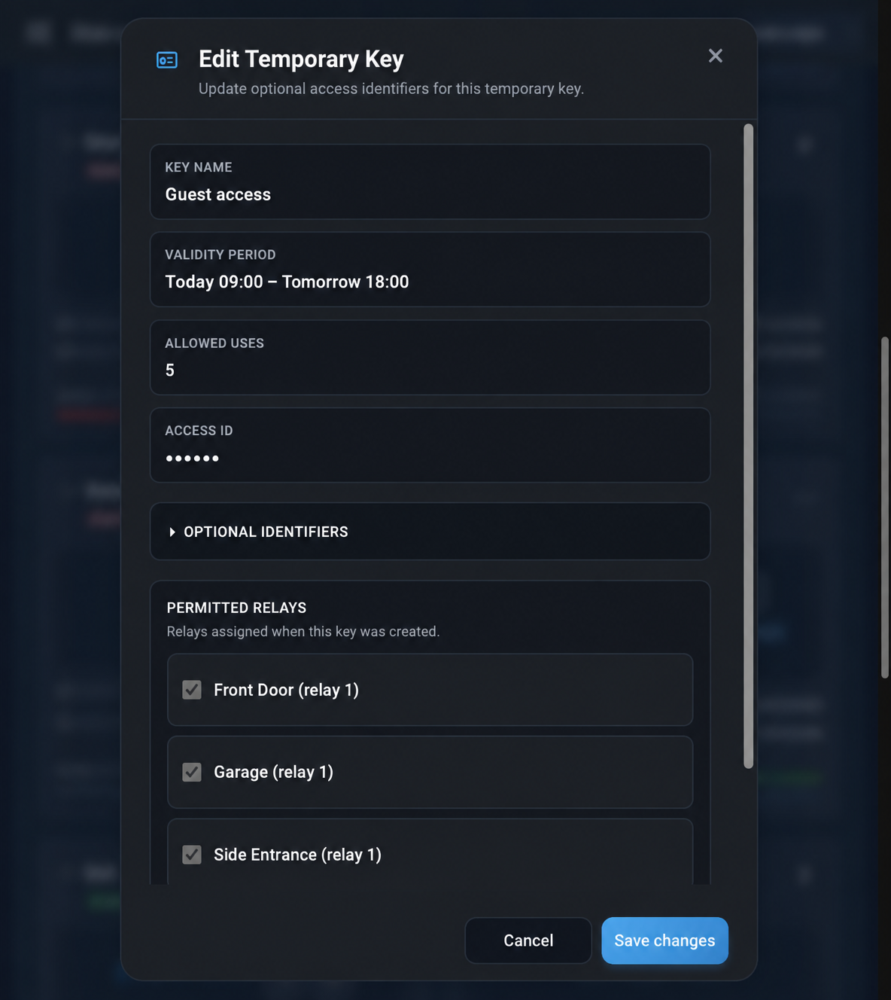](docs/images/temporary-key-edit-preview.png)

### Automations

#### Automations Wizard

Use **Akuvox SmartPlus → Automations** to build automations with a UI that allows you to easily construct triggers that target specific doors, event types & family members, and build notification events that take advantage of the event data (such as door/person names, live camera images, etc.).

[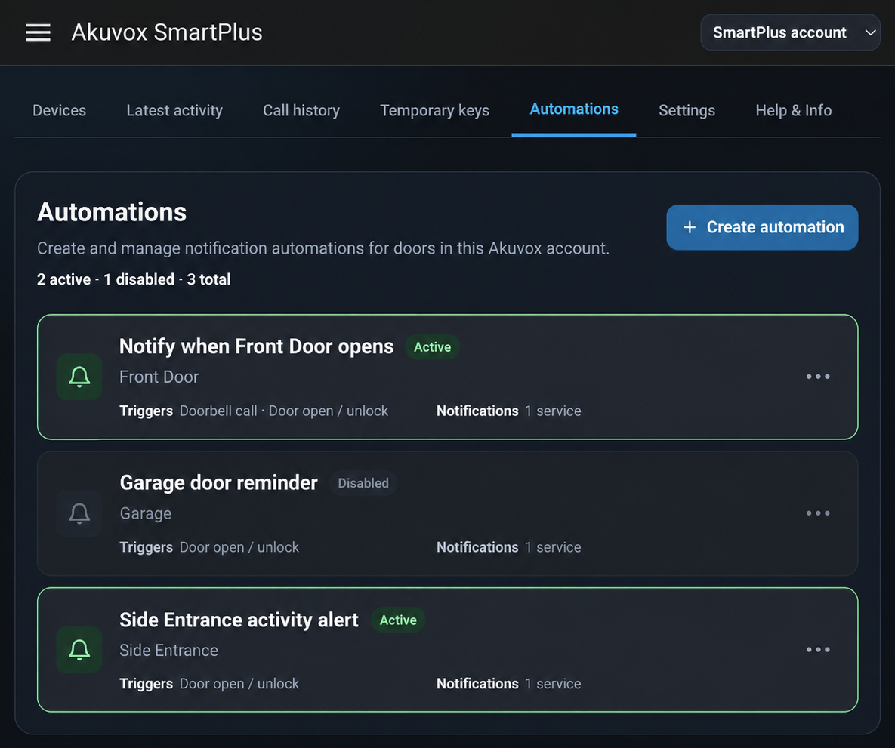](docs/images/automations-preview.png)

The six-step wizard selects doors, event types, optional people or temporary keys, notification services, delivery options, and a name before creating the automation.

<p align="center">
  <a href="docs/images/automations-wizard-step-1.png">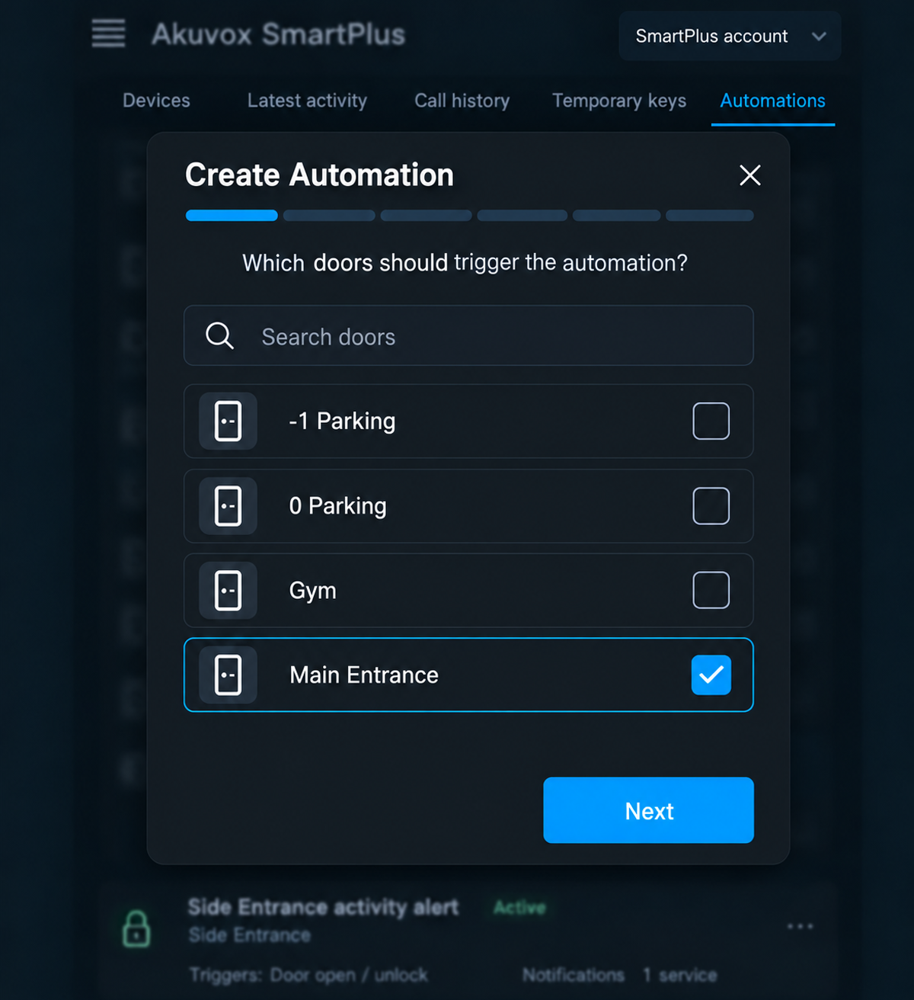</a>
  <a href="docs/images/automations-wizard-step-2.png">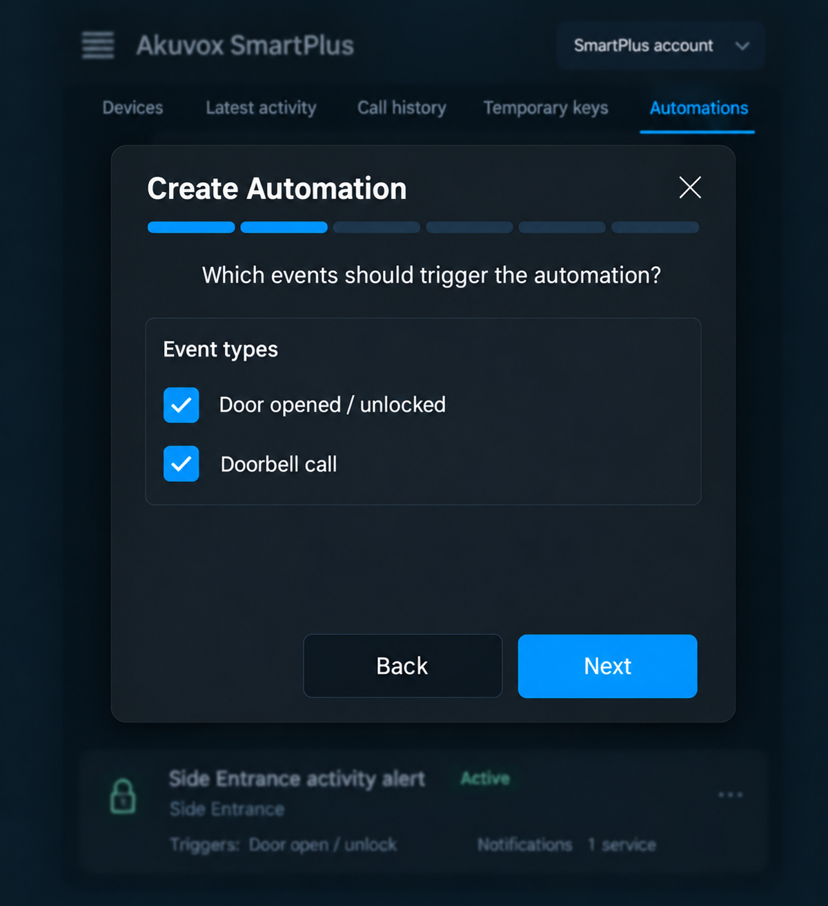</a>
  <a href="docs/images/automations-wizard-step-3.png">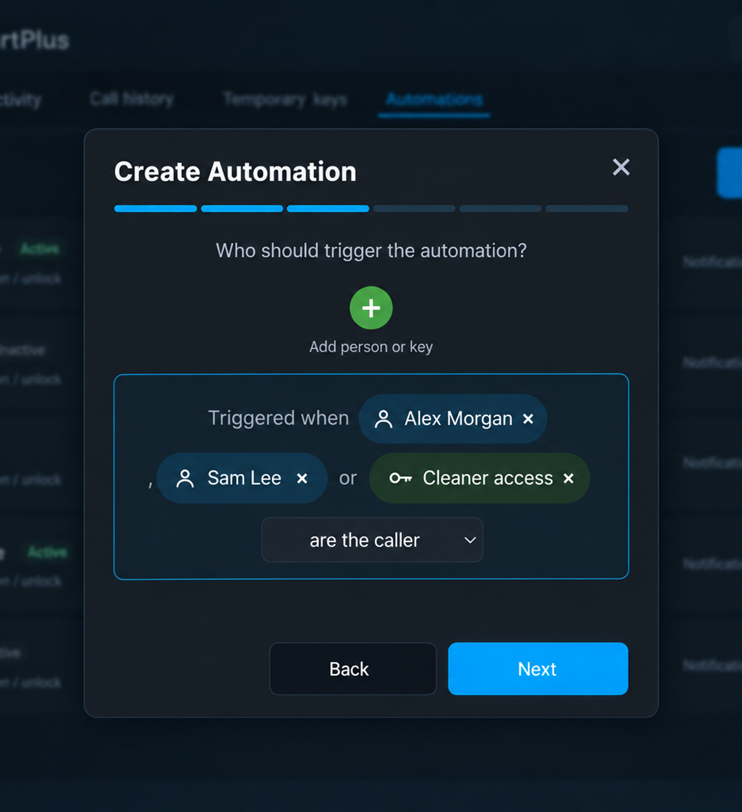</a>
</p>
<p align="center">
  <a href="docs/images/automations-wizard-step-4.png">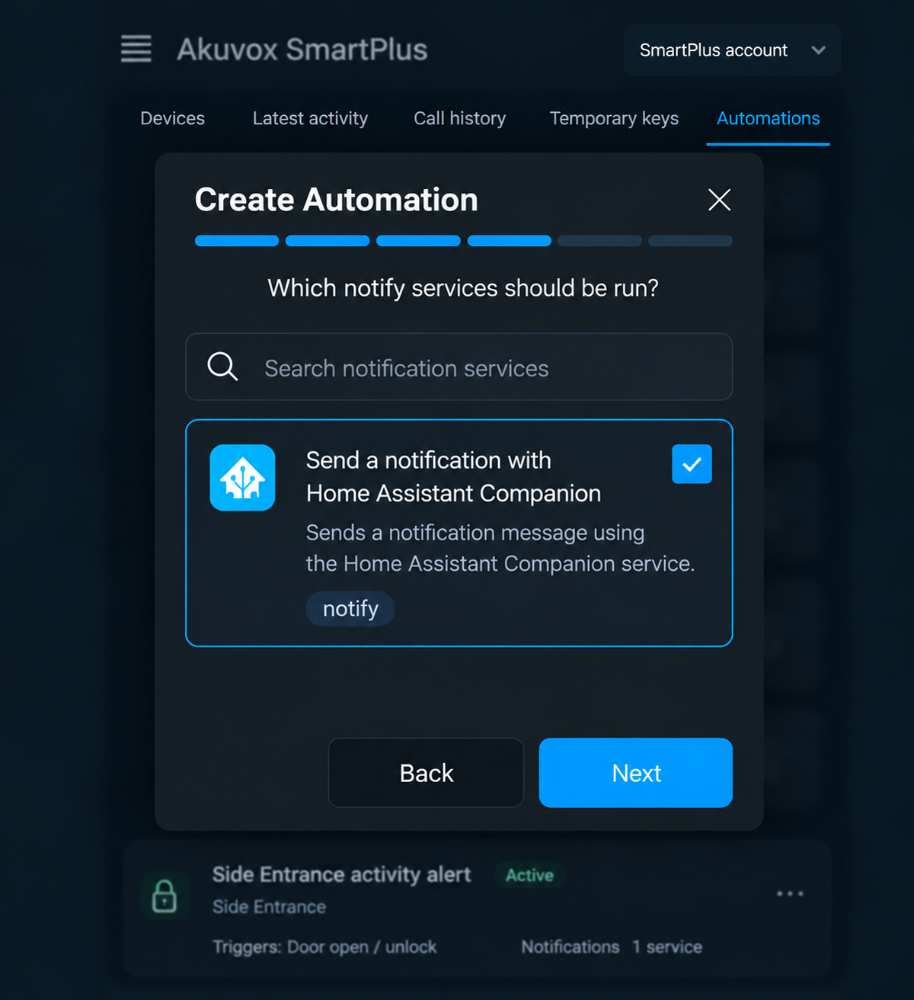</a>
  <a href="docs/images/automations-wizard-step-5.png">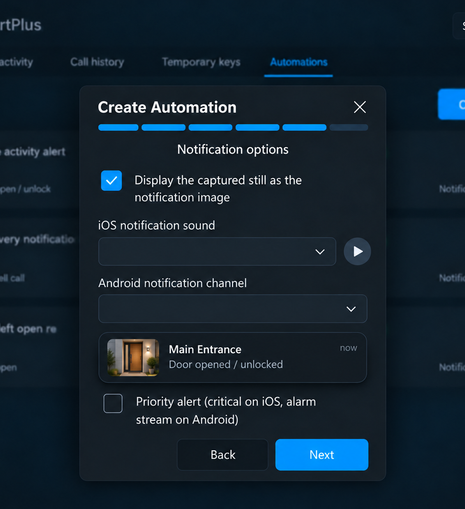</a>
  <a href="docs/images/automations-wizard-step-6.png">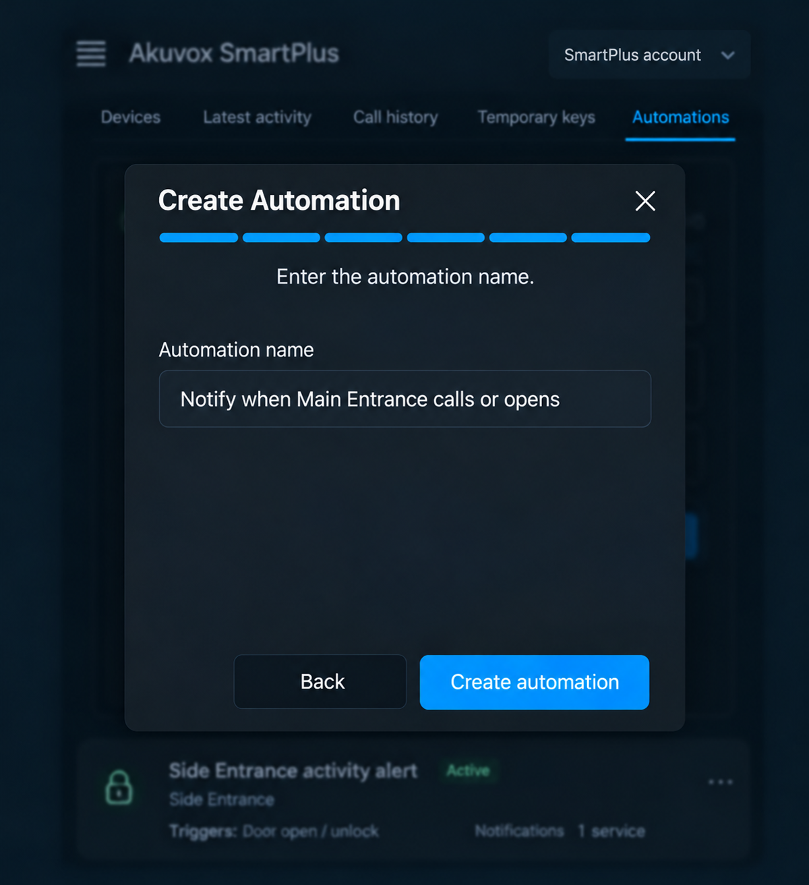</a>
</p>

#### Automations via UI/YAML

For full control you can also use the **Door opened** device trigger or listen for `akuvox_door_update` directly in your automations via Home Assistant's UI or YAML.

| Event property | Description | Possible or example values |
| --- | --- | --- |
| `location` | Home Assistant display name of the door that produced the event. | `Front Door`, `Garage` |
| `capture_type` | Type of SmartPlus activity. Known types are normalized; unrecognized SmartPlus values are passed through unchanged. | `Call`, `Face Unlock`, `Temp Key Unlock`, `Unlock on SmartPlus` |
| `initiator` | Person, visitor, or temporary-key name associated with the activity. May be empty. | `Visitor`, `Resident`, `Guest access`, `""` |
| `relay_name` | Relay involved in the action, when SmartPlus reports one. | `Relay1`, `1`, `""` |
| `pic_url` | Private SmartPlus URL for the event image, when available. | `https://…/event.jpg`, `""` |
| `device_id` | Home Assistant device ID for the matching door; present only when the door has a registered Home Assistant device. | Home Assistant device ID string |
| `temporary_key_id` | Stable SmartPlus key ID; present only for a temporary-key unlock when the key name resolves to exactly one configured key. | `guest-key-123` |

For compatibility, the original capitalized aliases (`Location`, `CaptureType`, `Initiator`, `RelayName`, `PicUrl`, and, when present, `TemporaryKeyId`) are emitted alongside their snake-case equivalents.

```yaml
alias: Notify when someone rings the front door
triggers:
  - trigger: event
    event_type: akuvox_door_update
    event_data:
      location: Front Door
      capture_type: Call
actions:
  - action: notify.notify
    data:
      title: Someone is at the front door
      message: "{{ trigger.event.data.initiator | default('Visitor', true) }} rang the bell."
mode: single
```

By default, the integration waits for an event image before it publishes an event. In **Settings → Door Events**, change that globally or for an individual camera when faster alerts matter more than including an image.

## Settings

Use **Akuvox SmartPlus → Settings** to configure event-image timing, local history, camera image options, account sharing, SIP account details, and debug logging.

### Share an account

Give another Home Assistant instance a restricted, revocable view without exposing your SmartPlus credentials.

1. On the source instance, open **Akuvox SmartPlus → Settings → Create pairing link**.
2. Choose the cameras, relays, key permissions, activity, calls, and optional expiry to share.
3. Transfer the one-time link securely. It expires after 10 minutes.
4. On the receiving instance, choose **Credentials from another Home Assistant** and paste the link.

Recipients receive only the data and permissions you select; they never sign in to SmartPlus directly. The source instance can review or revoke access at any time. Pairing requires a working HTTPS external URL.

### SIP export and local history

The panel can export SIP account mappings as a password-protected PDF. It can also retain local activity history, which defaults to a 5 MB limit. You can limit, clear, export, or import this history; set the limit to `0` for unlimited storage.

## Security and privacy

- Tokens, pairing secrets, and SIP credentials stay in Home Assistant's private storage and are not sent to the browser panel.
- Images are fetched only when requested and remain limited by the connected account or pairing permissions.
- Treat pairing links, private image URLs, SIP exports, and exported data like passwords.

## Contributing and testing

See [CONTRIBUTING.md](CONTRIBUTING.md) for contribution guidelines. To run the test suite locally, use Python 3.14 and install the development requirements.

To run tests:

```sh
scripts/setup
python3 -m unittest discover -s tests -v
```

The tests simulate SmartPlus responses and never access a live account.

## Help and support

For help, use the [Home Assistant community discussion](https://community.home-assistant.io/t/akuvox-smartplus-view-door-camera-feeds-open-doors-and-manage-temporary-keys/623187) or [open an issue](https://github.com/nimroddolev/akuvox/issues). Include your Home Assistant version, integration version, relevant logs, and steps to reproduce. Never include passwords, tokens, pairing links, SIP credentials, or private image URLs.

If this integration is useful to you, you can support its development:

[](https://www.buymeacoffee.com/nimroddolev)
